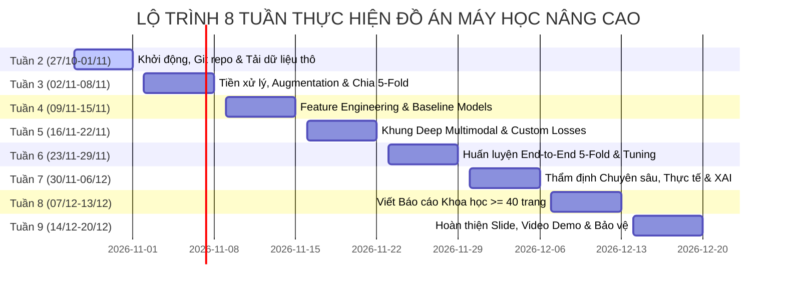

# KẾ HOẠCH TRIỂN KHAI STEP-BY-STEP CHI TIẾT THEO TUẦN VÀ TỪNG THÀNH VIÊN
## ĐỒ ÁN: MÁY HỌC NÂNG CAO (ADVANCED MACHINE LEARNING)
### Đề tài: Khung mô hình học máy đa phương thức nhận diện trạng thái rủi ro an toàn cho tài xế xe hai bánh (Multimodal Two-Wheel Driver Safety Risk Recognition)

---

## 1. Goal Description (Mục tiêu kế hoạch)

Tài liệu này cung cấp bản kế hoạch hành động chi tiết **từng bước (step-by-step)**, trải dài **8 tuần** (từ **Tuần 2: 27/10/2026** đến **Tuần 9: 20/12/2026**) cho toàn bộ 5 thành viên nhóm thực hiện đồ án môn **Máy học nâng cao** (giảng viên hướng dẫn: ThS./TS. Đặng Việt Dũng - Trường ĐH Công nghệ Thông tin, ĐHQG-HCM).

Kế hoạch phân định rõ ràng:
* **Theo từng tuần:** Mục tiêu tuần, các đầu việc kỹ thuật chi tiết của từng thành viên, file mã nguồn phụ trách, sản phẩm bàn giao (*Deliverables*), và tiêu chí hoàn thành (*Definition of Done - DoD*).
* **Theo từng cá nhân:** Chuyên trách rõ ràng, không dẫm chân lên nhau, có điểm phối hợp (*Sync Points*) và đánh giá chéo giữa các thành viên.

---

## 2. Thông tin Thành viên & Phân công Lĩnh vực Chuyên môn

```
+─────────────────────────────────────────────────────────────────────────────────────────────+
|                                    SƠ ĐỒ TỔ CHỨC NHÂN SỰ ĐỒ ÁN                              |
+─────────────────────────────────────────────────────────────────────────────────────────────+
                                               │
                                 ┌─────────────┴─────────────┐
                                 │       TRẦN HOÀNG HÔN      │
                                 │  (MSSV: 26410046) - Lead  │
                                 │   System & ML Architect   │
                                 └─────────────┬─────────────┘
                                               │
             ┌───────────────────┬─────────────┴─────────────┬───────────────────┐
             ▼                   ▼                           ▼                   ▼
    ┌─────────────────┐ ┌─────────────────┐         ┌─────────────────┐ ┌─────────────────┐
    │ NGUYỄN DUY KHANG│ │ PHẠM THÀNH TRUNG│         │   VŨ VĂN DUY    │ │  HOÀNG CAO SƠN  │
    │ (MSSV: 26410055)│ │ (MSSV: 26410141)│         │ (MSSV: 26410031)│ │ (MSSV: 25730061)│
    │  Computer Vision│ │   Bio-Signals   │         │  ML Modeling &  │ │ Data Engineering│
    │     Engineer    │ │  & Time-Series  │         │   Evaluation    │ │      & XAI      │
    └─────────────────┘ └─────────────────┘         └─────────────────┘ └─────────────────┘
```

1. **Trần Hoàng Hôn (MSSV: 26410046) – Trưởng nhóm / ML Architect:**
   * Quản lý tiến độ Git, review Pull Requests, thiết kế kiến trúc toán học đa phương thức (Multimodal Fusion), viết báo cáo tổng hợp và điều phối slide bảo vệ.
2. **Nguyễn Duy Khang (MSSV: 26410055) – Computer Vision Lead:**
   * Tiền xử lý dữ liệu ảnh nón bảo hiểm và hung khí, xây dựng Spatial Augmentation, huấn luyện backbone MobileNetV3-Small và Vision Baseline.
3. **Phạm Thành Trung (MSSV: 26410141) – Bio-Signal & Time-Series Specialist:**
   * Xử lý tín hiệu PPG chuỗi thời gian, lọc nhiễu chuyển động, trích xuất đặc trưng HRV (SDNN, RMSSD, pNN50), huấn luyện nhánh 1D-CNN + BiLSTM.
4. **Vũ Văn Duy (MSSV: 26410031) – ML Modeling & Evaluation Lead:**
   * Cài đặt và tối ưu các hàm mất mát (Focal Loss, Class-Balanced Loss, Cost Matrix), thiết lập kiểm định Stratified 5-Fold Cross-Validation, tính toán PR-AUC và Confusion Matrix.
5. **Hoàng Cao Sơn (MSSV: 25730061) – Data Engineering & Explainable AI (XAI):**
   * Xây dựng pipeline dữ liệu tự động, thu thập và gắn nhãn tập kiểm thử thực tế tại TP.HCM, cài đặt Grad-CAM trên nhánh ảnh và SHAP trên chuỗi nhịp tim.

---

## 3. Lộ trình Triển khai Chi tiết Step-by-Step theo từng Tuần (Tuần 2 đến Tuần 9)



---

### TUẦN 2 (27/10/2026 – 01/11/2026): KHỞI ĐỘNG, CHỐT BÀI TOÁN & THIẾT LẬP MÔI TRƯỜNG DỮ LIỆU

* **Mục tiêu chung:** Thống nhất định nghĩa bài toán toán học, chuẩn hóa môi trường làm việc trên GitHub repo `multimodal-driver-safety-ml`, tải và kiểm kê các bộ dữ liệu gốc (NTHU-DDD, WESAD, Roboflow Weapon).

| Thành viên | Nhiệm vụ cụ thể (Step-by-Step Tasks) | File phụ trách | Deliverables tuần 2 |
| :--- | :--- | :--- | :--- |
| **Trần Hoàng Hôn** | 1. Thiết lập Git workflow (quy định nhánh `main`, `develop`, `feature/*`).<br>2. Soạn thảo tài liệu hướng dẫn nhóm đóng góp code.<br>3. Rà soát file Thuyết minh toán học và Kế hoạch thực hiện.<br>4. Chủ trì buổi họp nhóm đầu tuần chốt phân công. | `CONTRIBUTING.md`<br>`README.md`<br>`docs/` | - Repo GitHub chuẩn hóa cấu trúc.<br>- Biên bản phân công chốt bài toán. |
| **Nguyễn Duy Khang** | 1. Tải bộ dữ liệu NTHU-DDD (các video tài xế đeo kính râm, khẩu trang).<br>2. Tải bộ dữ liệu Roboflow Weapon Detection (dao, hung khí).<br>3. Viết script kiểm tra số lượng ảnh, kích thước và phân bố định dạng. | `src/data/download_vision.py`<br>`data/external/` | - Dữ liệu ảnh thô tải về thư mục `data/raw/vision/`.<br>- Báo cáo thống kê số lượng ảnh. |
| **Phạm Thành Trung** | 1. Tải bộ dữ liệu WESAD từ Đại học Freiburg.<br>2. Viết script đọc file `.pkl` của 15 đối tượng, trích xuất tín hiệu nhịp tim PPG và đồng bộ nhãn thời gian.<br>3. Kiểm tra các đoạn dữ liệu bị mất tín hiệu hoặc nhiễu rác. | `src/data/download_bio.py`<br>`src/data/parse_wesad.py` | - File CSV/Parquet chứa chuỗi nhịp tim PPG thô theo từng đối tượng trong `data/raw/bio/`. |
| **Vũ Văn Duy** | 1. Thiết lập môi trường ảo Python (`requirements.txt` gồm PyTorch, torchvision, lightgbm, xgboost, scikit-learn, albumentations).<br>2. Viết unit test kiểm tra cài đặt thư viện và GPU CUDA.<br>3. Rà soát công thức Focal Loss và Cost-Sensitive Loss. | `requirements.txt`<br>`environment.yml`<br>`tests/test_env.py` | - File môi trường chuẩn hóa.<br>- Kiểm thử GPU pass 100%. |
| **Hoàng Cao Sơn** | 1. Lập kế hoạch quay video thực nghiệm mũ bảo hiểm ngoài phố TP.HCM.<br>2. Khởi tạo notebook EDA đầu tiên để vẽ phân bố số mẫu.<br>3. Thu thập 50 ảnh mẫu nón bảo hiểm thực tế để kiểm tra thử pipeline. | `notebooks/01_eda_and_data_preprocessing.ipynb`<br>`data/raw/local_samples/` | - Notebook EDA khung sườn ban đầu.<br>- Mẫu thử nghiệm nón bảo hiểm ngoài đường phố. |

* **DoD (Tiêu chí hoàn thành Tuần 2):** Toàn bộ 5 thành viên clone được repo về máy, chạy thành công `tests/test_env.py`, các file dữ liệu thô đã nằm sẵn trong `data/raw/`.

---

### TUẦN 3 (02/11/2026 – 08/11/2026): TIỀN XỬ LÝ DỮ LIỆU, DATA AUGMENTATION & CHIA 5-FOLD

* **Mục tiêu chung:** Chuẩn hóa dữ liệu ảnh về $96 \times 96$, làm sạch và cắt phân đoạn nhịp tim theo cửa sổ trượt $T=30$s, xây dựng Data Augmentation pipeline chống rung lắc, và chia tập Stratified Subject-Independent 5-Fold.

| Thành viên | Nhiệm vụ cụ thể (Step-by-Step Tasks) | File phụ trách | Deliverables tuần 3 |
| :--- | :--- | :--- | :--- |
| **Trần Hoàng Hôn** | 1. Định nghĩa Data Interface chuẩn: Cấu trúc dictionary `{'image': tensor, 'bio_seq': tensor, 'sos': int, 'label': int, 'subject_id': str}`.<br>2. Thiết kế logic chia tập `StratifiedGroupKFold(n_splits=5)`.<br>3. Tách biệt $20\%$ đối tượng làm Test Set độc lập cố định. | `src/data/dataset.py`<br>`src/data/splitter.py` | - File chỉ mục phân chia `splits_5fold.json` đảm bảo không Data Leakage giữa các tài xế. |
| **Nguyễn Duy Khang** | 1. Viết pipeline cắt crop vùng nón bảo hiểm và người ngồi sau.<br>2. Resize về kích thước chuẩn $3 \times 96 \times 96$, chuẩn hóa pixel $[-1, 1]$.<br>3. Cài đặt các bộ lọc Albumentations: Motion Blur ($5 \times 5, 9 \times 9$), Random Lighting ($\pm 40\%$), Shadow, Perspective Transform ($\pm 15^\circ$). | `src/data/vision_transforms.py`<br>`src/data/preprocess_vision.py` | - Pipeline tăng cường ảnh chống rung lắc xe máy hoạt động ổn định.<br>- Bộ ảnh tiền xử lý trong `data/processed/images/`. |
| **Phạm Thành Trung** | 1. Lọc thông dải Butterworth ($0.5 - 4.0$ Hz) trên tín hiệu PPG thô để loại bỏ nhiễu rung cơ học của xe máy.<br>2. Cắt chuỗi nhịp tim thành các cửa sổ trượt $T = 30$ giây (bước nhảy 1 giây).<br>3. Cài đặt các kỹ thuật tăng cường chuỗi: Additive Gaussian Noise, Time-warping ($\pm 15\%$). | `src/data/bio_transforms.py`<br>`src/data/preprocess_bio.py` | - Chuỗi nhịp tim sạch được lưu dạng tensor trong `data/processed/bio/`. |
| **Vũ Văn Duy** | 1. Cài đặt PyTorch `Dataset` và `DataLoader` nạp đồng bộ cả ảnh và chuỗi nhịp tim.<br>2. Viết kiểm thử tự động kiểm tra batch shape và kiểu dữ liệu.<br>3. Kiểm tra tính cân bằng tỷ lệ mẫu giữa các Fold (đảm bảo tỷ lệ 70% Normal : 20% Drowsy : 10% Assault). | `src/data/multimodal_dataset.py`<br>`tests/test_dataset.py` | - Module DataLoader đa phương thức hoàn chỉnh.<br>- Unit test DataLoader pass 100%. |
| **Hoàng Cao Sơn** | 1. Hoàn thiện notebook `01_eda_and_data_preprocessing.ipynb`.<br>2. Trực quan hóa hình ảnh trước và sau khi Augmentation.<br>3. Trực quan hóa biểu đồ sóng nhịp tim trước và sau khi lọc Butterworth.<br>4. Xuất các hình ảnh trực quan chất lượng cao vào `reports/figures/`. | `notebooks/01_eda_and_data_preprocessing.ipynb`<br>`reports/figures/` | - Notebook EDA hoàn thiện có biểu đồ trực quan.<br>- Báo cáo EDA dữ liệu gửi cả nhóm. |

* **DoD (Tiêu chí hoàn thành Tuần 3):** Chạy lệnh `python -m pytest tests/test_dataset.py` thành công; file `splits_5fold.json` được tạo hoàn chỉnh; notebook EDA đã có biểu đồ tăng cường dữ liệu.

---

### TUẦN 4 (09/11/2026 – 15/11/2026): FEATURE ENGINEERING & HUẤN LUYỆN MÔ HÌNH CƠ SỞ (BASELINES)

* **Mục tiêu chung:** Trích xuất đặc trưng biến thiên nhịp tim HRV và đặc trưng ảnh HOG/LBP; huấn luyện các mô hình Baseline (LightGBM, XGBoost, Single-Modal CNN) để thiết lập cột mốc so sánh hiệu năng.

| Thành viên | Nhiệm vụ cụ thể (Step-by-Step Tasks) | File phụ trách | Deliverables tuần 4 |
| :--- | :--- | :--- | :--- |
| **Trần Hoàng Hôn** | 1. Xây dựng khuôn khổ đánh giá chung (Evaluation Harness): hàm tính Macro-F1, Recall từng lớp, Precision từng lớp.<br>2. Thiết lập bảng so sánh benchmark kết quả trên Google Sheets / Notion nhóm.<br>3. Rà soát mã nguồn baseline của các thành viên. | `src/evaluation/metrics.py`<br>`docs/benchmark_tracking.md` | - Bộ đo lường chuẩn hóa dùng chung cho toàn bộ dự án.<br>- Bảng theo dõi tiến độ benchmark. |
| **Nguyễn Duy Khang** | 1. Trích xuất đặc trưng HOG trên vùng nón bảo hiểm và Local Binary Patterns (LBP).<br>2. Xây dựng và huấn luyện mô hình **MobileNetV3-Small (Vision-only)** trên tập 5-Fold.<br>3. Ghi nhận độ chính xác, Recall Drowsy và Recall Assault của mô hình chỉ dùng ảnh. | `src/features/vision_features.py`<br>`src/models/vision_only.py` | - Checkpoint mô hình Vision-only trong `models/checkpoints/vision_only.pth`.<br>- Báo cáo hiệu năng nhánh ảnh. |
| **Phạm Thành Trung** | 1. Hoàn thiện việc tích hợp hàm `compute_hrv_features` trích xuất 8 chỉ số HRV: mean HR, SDNN, RMSSD, pNN50, Delta hr...<br>2. Huấn luyện mô hình **BiLSTM (Bio-only)** trên chuỗi nhịp tim.<br>3. Đánh giá khả năng nhận diện ngủ gật khi chỉ có dữ liệu nhịp tim. | `src/features/hrv.py`<br>`src/models/bio_only.py` | - Checkpoint mô hình Bio-only trong `models/checkpoints/bio_only.pth`.<br>- Báo cáo hiệu năng nhánh nhịp tim. |
| **Vũ Văn Duy** | 1. Kết hợp vector đặc trưng thủ công (HOG + LBP + 8 HRV features) thành vector bảng.<br>2. Huấn luyện **LightGBM** và **XGBoost** trên dữ liệu bảng trích xuất.<br>3. Tinh chỉnh siêu tham số baseline (`max_depth`, `learning_rate`, `n_estimators`) bằng K-Fold CV. | `src/models/tabular_baselines.py`<br>`notebooks/02_baseline_models.ipynb` | - Mô hình LightGBM và XGBoost được huấn luyện.<br>- Notebook `02_baseline_models.ipynb` hoàn thiện. |
| **Hoàng Cao Sơn** | 1. Vẽ ma trận nhầm lẫn (Confusion Matrix) cho từng mô hình Baseline (LightGBM, Vision-only, Bio-only).<br>2. Phân tích hiện tượng: Khi nào Vision-only bị báo động giả? Khi nào Bio-only phản hồi chậm?<br>3. Lưu các biểu đồ phân tích lỗi vào `reports/figures/baseline_confusion_matrix.png`. | `notebooks/02_baseline_models.ipynb`<br>`reports/figures/` | - Phân tích chi tiết nhược điểm của các giải pháp đơn lẻ, làm động lực cho mô hình dung hợp. |

* **DoD (Tiêu chí hoàn thành Tuần 4):** Hoàn thành notebook `02_baseline_models.ipynb`; ghi nhận kết quả F1-Score của 4 mô hình: LightGBM, XGBoost, Vision-only, Bio-only; chỉ rõ các ca báo động sai để chuẩn bị cho giai đoạn dung hợp.

---

### TUẦN 5 (16/11/2026 – 22/11/2026): PHÁT TRIỂN KIẾN TRÚC HỌC SÂU ĐA PHƯƠNG THỨC & CUSTOM LOSSES

* **Mục tiêu chung:** Cài đặt 3 cấu trúc dung hợp đa phương thức (Early Fusion, Late Fusion, Cross-Modal Attention) kết hợp Focal Loss, Class-Balanced Loss và Ma trận Chi phí Bayes.

| Thành viên | Nhiệm vụ cụ thể (Step-by-Step Tasks) | File phụ trách | Deliverables tuần 5 |
| :--- | :--- | :--- | :--- |
| **Trần Hoàng Hôn** | 1. Thiết kế và cài đặt khối **Cross-Modal Attention Fusion** (`CrossAttentionFusion`): Chiếu nhịp tim thành Query, chiếu bản đồ đặc trưng thị giác thành Key/Value.<br>2. Cài đặt nhánh logic ghi đè nút SOS khẩn cấp.<br>3. Xây dựng lớp tổng thể `MultimodalDriverSafetyNet`. | `src/models/cross_attention_fusion.py`<br>`src/models/multimodal_net.py` | - Module mô hình hoàn chỉnh sẵn sàng cho huấn luyện end-to-end. |
| **Nguyễn Duy Khang** | 1. Xây dựng module trích xuất đặc trưng thị giác `VisualFeatureExtractor` sử dụng MobileNetV3-Small (bỏ tầng FC cuối, giữ lại feature map $C' \times H' \times W'$).<br>2. Thử nghiệm thêm backbone `ResNet-18` làm đối trọng so sánh.<br>3. Kiểm tra số lượng tham số và tính toán FLOPs của nhánh thị giác. | `src/models/backbones/mobilenetv3.py`<br>`src/models/backbones/resnet.py` | - Module backbone linh hoạt chuyển đổi giữa MobileNetV3 và ResNet. |
| **Phạm Thành Trung** | 1. Xây dựng module trích xuất chuỗi thời gian `TemporalBioExtractor` kết hợp 1D-CNN (kernel size 3, 5) và BiLSTM (32 hidden units).<br>2. Chuẩn hóa kích thước vector nhúng đầu ra $z_{\text{bio}} \in \mathbb{R}^d$ đồng bộ với chiều Query của Attention.<br>3. Cài đặt cơ chế Early Fusion (nối vector phẳng). | `src/models/temporal_extractor.py`<br>`src/models/early_fusion.py` | - Module trích xuất chuỗi thời gian hoàn chỉnh và mô hình Early Fusion. |
| **Vũ Văn Duy** | 1. Tối ưu hóa cài đặt `MultiClassFocalLoss`, `ClassBalancedFocalLoss` trong `src/models/losses.py`.<br>2. Cài đặt hàm tính tổn thất rủi ro bất đối xứng Bayes theo ma trận $\mathbf{C}$ phạt nặng FN ($C_{10}=50, C_{20}=200$).<br>3. Xây dựng module `Trainer` hỗ trợ gradient clipping, mixed precision (AMP fp16) và learning rate scheduler. | `src/models/losses.py`<br>`src/training/trainer.py` | - Module huấn luyện chuyên nghiệp có tích hợp đầy đủ các loss functions. |
| **Hoàng Cao Sơn** | 1. Cài đặt mô hình Late Fusion dựa trên Soft-voting có trọng số thích nghi $w_{\text{vis}} \cdot \mathbf{p}_{\text{vis}} + (1 - w_{\text{vis}}) \cdot \mathbf{p}_{\text{bio}}$.<br>2. Viết unit tests kiểm tra forward pass cho cả 3 cấu trúc dung hợp (Early, Late, Cross-Attention) với tensor ngẫu nhiên.<br>3. Đo đạc thời gian suy luận (Latency) trên CPU của từng cấu trúc. | `src/models/late_fusion.py`<br>`tests/test_models.py` | - Module Late Fusion.<br>- Toàn bộ unit tests cho các mô hình pass 100%. |

* **DoD (Tiêu chí hoàn thành Tuần 5):** Cả 3 kiến trúc dung hợp chạy mượt mà trên dữ liệu giả lập; module Trainer chạy được 1 epoch thử nghiệm mà không phát sinh lỗi kích thước tensor hay NaN loss.

---

### TUẦN 6 (23/11/2026 – 29/11/2026): HUẤN LUYỆN END-TO-END 5-FOLD & TINH CHỈNH SIÊU THAM SỐ

* **Mục tiêu chung:** Huấn luyện toàn diện mô hình Cross-Attention Multimodal qua 5 Folds độc lập; tinh chỉnh siêu tham số ($\gamma$ trong Focal Loss, learning rate, dropout); lưu checkpoint tốt nhất.

| Thành viên | Nhiệm vụ cụ thể (Step-by-Step Tasks) | File phụ trách | Deliverables tuần 6 |
| :--- | :--- | :--- | :--- |
| **Trần Hoàng Hôn** | 1. Điều phối quá trình huấn luyện 5 Folds trên máy có GPU.<br>2. Theo dõi hiện tượng Overfitting qua Loss đường cong Train/Val.<br>3. Lưu lại checkpoint trọng số có Macro-F1 cao nhất cho từng Fold.<br>4. Quản lý việc log kết quả thí nghiệm. | `notebooks/03_multimodal_fusion_training.ipynb`<br>`models/checkpoints/` | - Trọng số 5 Folds đã huấn luyện trong `models/checkpoints/fold_*.pth`.<br>- Bảng tổng hợp loss và accuracy qua từng epoch. |
| **Nguyễn Duy Khang** | 1. Đánh giá độ ổn định của nhánh thị giác: kiểm tra các mẫu ảnh bị mờ hoặc ngược sáng xem mô hình xử lý ra sao.<br>2. Thực hiện Fine-tuning các tầng sâu của MobileNetV3 với learning rate nhỏ ($10^{-4}$). | `src/training/finetune_vision.py` | - Mô hình sau khi fine-tuning đạt độ nhạy nhận diện nón bảo hiểm cao hơn. |
| **Phạm Thành Trung** | 1. Phân tích độ nhạy của nhánh nhịp tim đối với độ dài cửa sổ trượt $T$ ($T=15$s vs $T=30$s vs $T=60$s).<br>2. Kiểm tra hiện tượng trễ phản hồi của nhịp tim và báo cáo lại cho nhóm. | `notebooks/experiments_hr_window.ipynb` | - Báo cáo thực nghiệm lựa chọn cửa sổ tối ưu $T = 30$ giây. |
| **Vũ Văn Duy** | 1. Thử nghiệm so sánh hiệu quả giữa các hàm mất mát: Cross-Entropy vs Focal Loss ($\gamma = 2.0$) vs Class-Balanced Loss.<br>2. Ghi nhận số liệu: Focal Loss giúp cải thiện Recall của lớp Tấn công từ bao nhiêu % lên bao nhiêu %?<br>3. Thực hiện kiểm tra rủi ro chi phí Bayes. | `src/evaluation/loss_ablation.py`<br>`reports/figures/loss_comparison.png` | - Nghiên cứu bóc tách thành phần (Ablation Study) chứng minh tính ưu việt của Focal Loss. |
| **Hoàng Cao Sơn** | 1. Thiết lập script đo lường tốc độ suy luận (FPS & Latency tính bằng mili-giây) trên CPU máy tính cá nhân mô phỏng thiết bị biên.<br>2. Kiểm tra bộ nhớ RAM đỉnh điểm khi chạy suy luận một batch.<br>3. Lưu trữ toàn bộ kết quả đo đạc vào file CSV. | `src/evaluation/benchmark_speed.py`<br>`reports/speed_benchmarks.csv` | - Bảng số liệu tốc độ xử lý: Đạt $\ge 15$ FPS, thời gian trễ $< 70$ ms trên CPU thông thường. |

* **DoD (Tiêu chí hoàn thành Tuần 6):** Hoàn thành huấn luyện 5 Folds; mô hình Cross-Attention đạt Macro-F1 $\ge 90\%$, Recall Drowsy $\ge 95\%$, Recall Assault $\ge 98\%$; có bảng so sánh Ablation Study về hàm mất mát.

---

### TUẦN 7 (30/11/2026 – 06/12/2026): THẨM ĐỊNH CHUYÊN SÂU, KIỂM THỬ THỰC TẾ & EXPLAINABLE AI (XAI)

* **Mục tiêu chung:** Đánh giá trên tập Held-out Test Set độc lập; vẽ đường cong PR-AUC; triển khai Grad-CAM và SHAP; kiểm thử mô hình trên dữ liệu thực tế tại TP.HCM.

| Thành viên | Nhiệm vụ cụ thể (Step-by-Step Tasks) | File phụ trách | Deliverables tuần 7 |
| :--- | :--- | :--- | :--- |
| **Trần Hoàng Hôn** | 1. Xây dựng notebook tổng kết thẩm định `04_evaluation_and_xai.ipynb`.<br>2. Tính toán tổng hợp kết quả trung bình và độ lệch chuẩn qua 5 Folds ($\text{Mean} \pm \text{Std}$).<br>3. Đánh giá tổng tổn thất chi phí Bayes trên tập kiểm thử độc lập. | `notebooks/04_evaluation_and_xai.ipynb`<br>`reports/final_metrics_summary.json` | - Báo cáo số liệu kiểm định cuối cùng chuẩn xác từng con số thập phân. |
| **Nguyễn Duy Khang** | 1. Cài đặt **Grad-CAM** trích xuất bản đồ kích hoạt nhiệt từ tầng tích chập cuối của MobileNetV3.<br>2. Tạo các hình ảnh đối chiếu: Ảnh gốc $\rightarrow$ Heatmap Grad-CAM $\rightarrow$ Vùng chồng ảnh (Overlay).<br>3. Minh chứng mô hình tập trung vào chóp nón bảo hiểm cúi gục và cánh tay cầm dao/hung khí. | `src/evaluation/gradcam.py`<br>`reports/figures/gradcam_drowsy.png`<br>`reports/figures/gradcam_assault.png` | - Bộ hình ảnh trực quan Grad-CAM sắc nét phục vụ đưa vào báo cáo và slide. |
| **Phạm Thành Trung** | 1. Cài đặt **SHAP (SHapley Additive exPlanations)** trên vector đặc trưng nhịp tim HRV.<br>2. Tạo biểu đồ `shap.summary_plot` và `shap.waterfall_plot` cho từng trường hợp dự đoán.<br>3. Chứng minh giá trị SHAP của nhịp tim giúp kéo xác suất về "Bình thường" khi tài xế cúi đầu trong trạng thái tỉnh táo. | `src/evaluation/shap_analysis.py`<br>`reports/figures/shap_summary.png` | - Biểu đồ SHAP giải thích cơ chế loại bỏ báo động giả của nhánh sinh trắc học. |
| **Vũ Văn Duy** | 1. Vẽ đường cong Precision-Recall (**PR-AUC Curve**) cho cả 3 lớp trên cùng một đồ thị.<br>2. Vẽ **Normalized Confusion Matrix** với màu sắc trực quan (heatmap Seaborn).<br>3. So sánh đối đầu giữa Baseline (LightGBM) và Mô hình đề xuất (Cross-Attention Network). | `src/evaluation/plot_curves.py`<br>`reports/figures/pr_curve.png`<br>`reports/figures/confusion_matrix.png` | - Đồ thị PR-AUC và Ma trận nhầm lẫn chuẩn hóa hoàn chỉnh chuẩn xuất bản. |
| **Hoàng Cao Sơn** | 1. Đưa mô hình chạy thử trên tập dữ liệu video thực tế thu thập tại TP.HCM (tài xế xe ôm đội mũ bảo hiểm các loại).<br>2. Đánh giá tỷ lệ nhận diện đúng trên dữ liệu thực tế ngoài phố (Out-of-Distribution - OOD Testing).<br>3. Ghi lại các trường hợp nhận diện sai ngoài đường phố để đưa vào phần thảo luận hạn chế đề tài. | `src/evaluation/test_realworld.py`<br>`reports/realworld_evaluation_report.md` | - Báo cáo thực nghiệm dữ liệu thực tế tại TP.HCM. |

* **DoD (Tiêu chí hoàn thành Tuần 7):** Hoàn thành toàn bộ notebook `04_evaluation_and_xai.ipynb`; có đầy đủ hình ảnh Grad-CAM, biểu đồ SHAP, đồ thị PR-AUC và số liệu kiểm thử thực tế.

---

### TUẦN 8 (07/12/2026 – 13/12/2026): HOÀN THIỆN BÁO CÁO KHOA HỌC ($\ge 40$ TRANG) & ĐÓNG GÓI SẢN PHẨM

* **Mục tiêu chung:** Soạn thảo, biên tập và hoàn thiện toàn diện Quyển Báo cáo khoa học Word + PDF ($\ge 40$ trang) theo chuẩn cấu trúc đồ án UIT; đóng gói mã nguồn và tài liệu hướng dẫn tái lập kết quả.

| Thành viên | Nhiệm vụ cụ thể (Step-by-Step Tasks) | File phụ trách | Deliverables tuần 8 |
| :--- | :--- | :--- | :--- |
| **Trần Hoàng Hôn** | 1. Điều phối viết báo cáo, trực tiếp viết: Lời mở đầu, Tóm tắt (Abstract), Chương 1 (Bối cảnh thực tiễn), Chương 3 (Định nghĩa bài toán toán học), Chương 5 (Kiến trúc đề xuất), và Kết luận.<br>2. Định dạng văn bản, canh lề, mục lục tự động, danh mục bảng biểu và hình ảnh. | `docs/Bao_Cao_Do_An_May_Hoc_Nang_Cao.docx`<br>`docs/generate_full_report.py` | - Bản thảo hoàn chỉnh của Quyển báo cáo $\ge 40$ trang. |
| **Nguyễn Duy Khang** | 1. Soạn thảo Chương 4 (Kỹ thuật dữ liệu thị giác): Mô tả bộ dữ liệu NTHU-DDD, Roboflow Weapon, các kỹ thuật cắt crop và Spatial Data Augmentation.<br>2. Chèn các hình ảnh minh họa mẫu nón bảo hiểm và hung khí vào báo cáo. | `docs/chapters/chap4_vision_data.md` | - Toàn bộ nội dung và hình ảnh của Chương 4. |
| **Phạm Thành Trung** | 1. Soạn thảo Chương 4 (Kỹ thuật dữ liệu sinh lý học): Mô tả bộ dữ liệu WESAD, giải thích nguyên lý lọc Butterworth và các công thức toán trích xuất 8 chỉ số HRV.<br>2. Chèn đồ thị sóng nhịp tim và bảng thống kê HRV. | `docs/chapters/chap4_bio_data.md` | - Toàn bộ nội dung và đồ thị của phần chuỗi thời gian. |
| **Vũ Văn Duy** | 1. Soạn thảo Chương 6 (Thực nghiệm & Đánh giá kết quả): Bảng so sánh 5 Folds, phân tích ma trận nhầm lẫn, phân tích PR-AUC, và bảng Ablation Study hàm mất mát.<br>2. Viết phân tích lý giải tại sao mô hình đề xuất vượt trội so với Baseline. | `docs/chapters/chap6_evaluation.md` | - Toàn bộ bảng biểu số liệu và phân tích kết quả của Chương 6. |
| **Hoàng Cao Sơn** | 1. Soạn thảo Chương 7 (Explainable AI & Khả năng triển khai thực tế): Phân tích chi tiết hình ảnh Grad-CAM, biểu đồ SHAP và kết quả thực nghiệm đường phố TP.HCM.<br>2. Rà soát chuẩn hóa danh mục tài liệu tham khảo theo định dạng IEEE/APA. | `docs/chapters/chap7_xai_and_discussion.md`<br>`docs/references.bib` | - Toàn bộ nội dung XAI, thảo luận mở rộng và danh mục trích dẫn chuẩn. |

* **DoD (Tiêu chí hoàn thành Tuần 8):** Xuất bản file `Bao_Cao_Do_An_May_Hoc_Nang_Cao.docx` và `Bao_Cao_Do_An_May_Hoc_Nang_Cao.pdf` với độ dài $\ge 40$ trang, đầy đủ bảng số liệu thực nghiệm, đồ thị và hình ảnh minh chứng.

---

### TUẦN 9 (14/12/2026 – 20/12/2026): SLIDE THUYẾT TRÌNH, VIDEO DEMO & BẢO VỆ ĐỒ ÁN

* **Mục tiêu chung:** Chuẩn bị Slide báo cáo chuyên nghiệp, quay video clip demo mô hình chạy thực nghiệm thực tế, tổng duyệt phản biện nội bộ và bảo vệ đồ án trước giảng viên.

| Thành viên | Nhiệm vụ cụ thể (Step-by-Step Tasks) | File phụ trách | Deliverables tuần 9 |
| :--- | :--- | :--- | :--- |
| **Trần Hoàng Hôn** | 1. Thiết kế bộ Slide thuyết trình chính (PowerPoint / Canva) theo cấu trúc chuẩn: Vấn đề $\rightarrow$ Phương pháp $\rightarrow$ Thực nghiệm $\rightarrow$ Demo $\rightarrow$ Kết luận.<br>2. Phân chia lượt nói cho 5 thành viên trong buổi bảo vệ.<br>3. Chủ trì buổi bảo vệ thử (Mock Defense), bấm giờ và góp ý phản biện. | `docs/Slide_Bao_Ve_Do_An_ML.pptx`<br>`docs/script_thuyet_trinh.md` | - Slide bảo vệ chuyên nghiệp 25–30 slides.<br>- Kịch bản thuyết trình chi tiết. |
| **Nguyễn Duy Khang** | 1. Chuẩn bị phần trình bày về nhánh Thị giác máy tính và cơ chế nhận diện nón bảo hiểm.<br>2. Chuẩn bị các câu hỏi phản biện liên quan đến góc nghiêng nón, điều kiện thiếu sáng và che khuất. | `docs/qa_defense_preparation.md` | - Slide nhánh Vision & tài liệu ứng đáp phản biện. |
| **Phạm Thành Trung** | 1. Chuẩn bị phần trình bày về nhánh Tín hiệu sinh học và vai trò của HRV.<br>2. Chuẩn bị các câu hỏi phản biện liên quan đến độ trễ sinh lý của nhịp tim và nhiễu do rung lắc xe. | `docs/qa_defense_preparation.md` | - Slide nhánh Bio-Signals & tài liệu ứng đáp phản biện. |
| **Vũ Văn Duy** | 1. Chuẩn bị phần trình bày về Mô hình toán học, Focal Loss, Ma trận chi phí Bayes và phân tích ma trận nhầm lẫn.<br>2. Sẵn sàng giải thích cặn kẽ các con số thập phân trong bảng kết quả. | `docs/qa_defense_preparation.md` | - Slide nhánh ML Evaluation & tài liệu ứng đáp phản biện. |
| **Hoàng Cao Sơn** | 1. Quay và biên tập Video clip demo (thời lượng 2–3 phút): Mô phỏng tài xế gục đầu ngủ gật và kịch bản người sau giơ hung khí, kèm hiển thị nhịp tim thời gian thực và còi cảnh báo.<br>2. Đóng gói mã nguồn lần cuối vào Release trên GitHub (`v1.0.0`). | `docs/demo_video_link.txt`<br>`GitHub Releases v1.0.0` | - Video clip demo thực tế độ phân giải cao.<br>- GitHub Release hoàn chỉnh sẵn sàng nộp link. |

* **DoD (Tiêu chí hoàn thành Tuần 9):** Nhóm hoàn thành bảo vệ thử nghiệm đạt yêu cầu về thời gian (15 phút thuyết trình + 10 phút hỏi đáp); nộp đầy đủ quyển báo cáo PDF, slide PPTX, mã nguồn GitHub và video demo cho giảng viên ThS./TS. Đặng Việt Dũng.

---

## 4. Bảng Tổng hợp Sản phẩm Bàn giao theo từng Thành viên (Final Deliverables by Member)

```
+─────────────────────────────────────────────────────────────────────────────────────────────+
|                     MA TRẬN SẢN PHẨM BÀN GIAO CUỐI CÙNG THEO TỪNG THÀNH VIÊN                |
+─────────────────────────────────────────────────────────────────────────────────────────────+
```

| Thành viên | Trọng tâm chuyên môn | Sản phẩm mã nguồn (Codebase) | Sản phẩm báo cáo khoa học |
| :--- | :--- | :--- | :--- |
| **Trần Hoàng Hôn** | Kiến trúc tổng thể & Dung hợp Attention | - `src/models/cross_attention_fusion.py`<br>- `src/models/multimodal_net.py`<br>- `src/data/splitter.py` | - Chủ biên Quyển báo cáo $\ge 40$ trang.<br>- Slide bảo vệ PowerPoint tổng thể.<br>- Điều phối bảo vệ đồ án. |
| **Nguyễn Duy Khang** | Thị giác máy tính & Nón bảo hiểm | - `src/data/vision_transforms.py`<br>- `src/models/backbones/mobilenetv3.py`<br>- `src/models/vision_only.py` | - Chương 4: Kỹ thuật dữ liệu ảnh & Augmentation.<br>- Ảnh mẫu nón bảo hiểm và hung khí. |
| **Phạm Thành Trung** | Chuỗi thời gian sinh học & HRV | - `src/features/hrv.py`<br>- `src/data/bio_transforms.py`<br>- `src/models/temporal_extractor.py` | - Chương 4: Kỹ thuật tín hiệu nhịp tim & lọc sóng.<br>- Đồ thị biến thiên nhịp tim HRV. |
| **Vũ Văn Duy** | Hàm mất mát & Thẩm định khoa học | - `src/models/losses.py`<br>- `src/training/trainer.py`<br>- `src/evaluation/metrics.py` | - Chương 6: Bảng thực nghiệm 5-Fold, PR-AUC, Ma trận nhầm lẫn chuẩn hóa, Ablation Study. |
| **Hoàng Cao Sơn** | Data Engineering, XAI & Thực tế | - `src/evaluation/gradcam.py`<br>- `src/evaluation/shap_analysis.py`<br>- `src/evaluation/test_realworld.py` | - Chương 7: Hình ảnh Grad-CAM, đồ thị SHAP, Báo cáo thực nghiệm đường phố TP.HCM, Video Demo. |

---

## 5. Quy chế Phối hợp & Họp Nhóm Định kỳ (Team Working Agreements)

1. **Lịch họp cố định:**
   * **Họp đầu tuần (Tối Chủ Nhật lúc 20h00 qua Google Meet / Teams):** Đánh giá việc hoàn thành tuần trước, rà soát blocker, giao việc chi tiết tuần mới.
   * **Đồng bộ giữa tuần (Tối Thứ Tư lúc 21h00 qua Zalo nhóm):** Cập nhật tiến độ 5 phút, hỗ trợ các thành viên gặp khó khăn kỹ thuật.
2. **Quy chuẩn Git & Code Quality:**
   * Không commit trực tiếp vào nhánh `main`. Mọi tính năng mới được tạo nhánh `feature/<ten-tinh-nang>`.
   * Tạo Pull Request (PR) và phải có ít nhất **01 thành viên khác review + Trưởng nhóm duyệt** trước khi merge vào `main`.
   * Mỗi đoạn code mới phải có docstring giải thích tham số đầu vào và kiểu đầu ra.
3. **Tiêu chí Đánh giá Đóng góp Thành viên (Peer Review):**
   * Đánh giá công bằng dựa trên khối lượng công việc hoàn thành đúng hạn (On-time Delivery) và chất lượng mã nguồn/nội dung báo cáo đóng góp.
   * Tất cả 5 thành viên đều nắm vững toàn bộ kiến trúc để sẵn sàng trả lời bất kỳ câu hỏi phản biện nào của giảng viên.

---

## 6. Proposed Changes to Project Workspace

Sau khi kế hoạch này được bạn phê duyệt, các tệp sau sẽ được tạo và cập nhật vào repository của dự án:

### [Documentation & Planning]
#### [NEW] `Ke_Hoach_Chi_Tiet_Tung_Tuan_Va_Thanh_Vien.md`
Tài liệu kế hoạch chi tiết từng bước theo tuần và thành viên ở định dạng Markdown trong thư mục gốc đồ án.

#### [NEW] `docs/Ke_Hoach_Chi_Tiet_Tung_Tuan_Va_Thanh_Vien.md`
Bản sao trong thư mục `docs/` để đồng bộ cấu trúc lưu trữ.

#### [NEW] `docs/generate_weekly_plan_docx.py`
Script Python sinh file Word chuẩn học thuật Times New Roman cho bản kế hoạch tuần chi tiết.

#### [NEW] `Ke_Hoach_Chi_Tiet_Tung_Tuan_Va_Thanh_Vien.docx` & `docs/Ke_Hoach_Chi_Tiet_Tung_Tuan_Va_Thanh_Vien.docx`
File Word chuẩn để các thành viên in ấn và theo dõi tiến độ hàng ngày.

#### [MODIFY] `README.md`
Cập nhật bảng hồ sơ tài liệu của đồ án, bổ sung liên kết đến Kế hoạch chi tiết theo tuần và từng thành viên.

### [Git Sync]
Commit và push toàn bộ các văn kiện mới lên GitHub repository `mrkiss-it/multimodal-driver-safety-ml`.

---

## 7. Verification Plan (Kế hoạch Kiểm chứng)

### Automated Verification
1. Chạy script sinh tài liệu Word:
   ```powershell
   python "D:\Trí tuệ nhân tạo\HK3\Máy học nâng cao\Đồ án\docs\generate_weekly_plan_docx.py"
   ```
2. Kiểm tra tính toàn vẹn của các file tạo mới:
   ```powershell
   Test-Path "D:\Trí tuệ nhân tạo\HK3\Máy học nâng cao\Đồ án\Ke_Hoach_Chi_Tiet_Tung_Tuan_Va_Thanh_Vien.docx"
   Test-Path "D:\Trí tuệ nhân tạo\HK3\Máy học nâng cao\Đồ án\Ke_Hoach_Chi_Tiet_Tung_Tuan_Va_Thanh_Vien.md"
   ```
3. Kiểm tra đồng bộ GitHub:
   ```powershell
   git status
   git log -1 --stat
   ```

### Manual Verification
* Kiểm tra file Word tạo ra có đúng định dạng chuẩn UIT (font Times New Roman, lề trang 2cm-2cm-3cm-2cm, bảng biểu rõ ràng, không lỗi font Tiếng Việt).
* Kiểm tra lịch trình tuần khớp chính xác với lịch học Thứ Sáu hàng tuần của thầy Đặng Việt Dũng.
