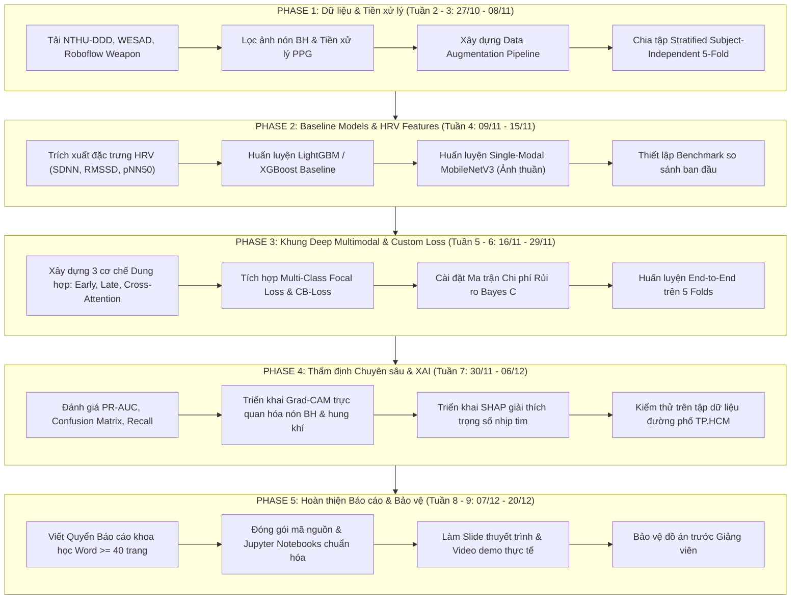

# KẾ HOẠCH TRIỂN KHAI ĐỒ ÁN MÔN MÁY HỌC NÂNG CAO (ADVANCED MACHINE LEARNING)
## Đề tài: Khung mô hình học máy đa phương thức nhận diện trạng thái rủi ro an toàn cho tài xế xe hai bánh (Computer Vision & Wearable Bio-Signals)

---

## 1. Goal Description (Mục tiêu tổng quát)

Kế hoạch này vạch ra lộ trình kỹ thuật và tổ chức thực hiện trong 8 tuần (từ **27/10/2026** đến **20/12/2026**) cho nhóm 5 sinh viên thuộc Trường Đại học Công nghệ Thông tin – ĐHQG-HCM thực hiện đồ án môn **Máy học nâng cao** (giảng viên: ThS./TS. Đặng Việt Dũng).

Mục tiêu cốt lõi là xây dựng một hệ thống học máy đa phương thức hoàn chỉnh (*Multimodal Machine Learning Pipeline*) có khả năng phân loại 3 trạng thái của tài xế xe máy:
1. **Lớp 0 (Normal Driving):** Lái xe bình thường, an toàn.
2. **Lớp 1 (Drowsiness):** Ngủ gật tức thì (*micro-sleep*), đầu gục quá $25^\circ$, nhịp tim sụt giảm.
3. **Lớp 2 (Assault / Extreme Hazard):** Bị khách ngồi sau uy hiếp/tấn công hoặc giơ hung khí, nhịp tim tăng vọt do hoảng sợ hoặc tài xế kích hoạt SOS.

Kế hoạch giải quyết đồng thời các thách thức lớn nhất của học máy thực tiễn:
* **Vượt qua rào cản che khuất khuôn mặt (Severe Occlusion):** Mô hình hóa tư thế Mũ bảo hiểm (*Helmet Pose*) thay cho mốc mặt (*Face Landmarks*).
* **Xử lý mất cân bằng dữ liệu cực độ (Extreme Class Imbalance):** Ứng dụng *Multi-Class Focal Loss* và *Class-Balanced Loss*.
* **Tối ưu hóa rủi ro bất đối xứng chi phí (Cost-Sensitive Bayes Risk):** Phạt nặng sai số bỏ sót nguy hiểm (*False Negative* cho lớp Nguy hiểm và Ngủ gật).
* **Chuẩn mực thẩm định khoa học (Academic Rigor):** Kiểm định *Stratified Subject-Independent 5-Fold Cross-Validation*, trực quan hóa *PR-AUC*, và giải thích mô hình bằng *Explainable AI (Grad-CAM & SHAP)*.

---

## 2. User Review Required (Các điểm cần thống nhất với nhóm)

> [!IMPORTANT]
> **Các quyết định kỹ thuật trọng tâm cần nhóm xác nhận trước khi bước vào pha huấn luyện mô hình:**
> 1. **Cấu trúc mạng trích xuất thị giác (Visual Backbone):** Nhóm ưu tiên sử dụng `MobileNetV3-Small` làm backbone chính nhờ khả năng chạy mượt trên CPU/Edge, hay muốn huấn luyện thêm `ResNet-18` / `EfficientNet-B0` trên máy chủ GPU để lấy chuẩn đối chứng cao nhất?
> 2. **Tần số lấy mẫu cửa sổ chuỗi thời gian nhịp tim:** Độ dài cửa sổ trượt $T$ cho tín hiệu nhịp tim PPG: đề xuất $T = 30$ giây hoặc $T = 60$ giây với bước nhảy trượt 1 giây để tính toán HRV (SDNN, RMSSD).
> 3. **Công cụ quản lý thí nghiệm (Experiment Tracking):** Đề xuất sử dụng `MLflow` hoặc `Weights & Biases (WandB)` để log tự động Loss, Confusion Matrix, PR-AUC qua từng Fold nhằm phục vụ việc trích xuất biểu đồ vào báo cáo cuối kỳ.

---

## 3. Lộ trình thực hiện chi tiết 8 tuần (Phase-by-Phase Roadmap)



---

### Giai đoạn 1: Chuẩn bị Dữ liệu, Phân tích Khám phá & Pipeline Tăng cường (Tuần 2 – 3: 27/10 – 08/11/2026)
* **Mục tiêu:** Thu thập, làm sạch, đồng bộ hóa các luồng dữ liệu đa phương thức và ngăn chặn rò rỉ dữ liệu (*Data Leakage*).
* **Nhiệm vụ cụ thể:**
  1. Tải và giải nén các tập dữ liệu: NTHU-DDD (các video tài xế đeo kính râm, khẩu trang), Roboflow Weapon Detection (>4.200 ảnh dao/hung khí), và WESAD (file pickle dữ liệu PPG nhịp tim).
  2. Xây dựng notebook `01_eda_and_data_preprocessing.ipynb`:
     * Phân tích phân bố nhãn (tỷ lệ 70% Normal : 20% Drowsy : 10% Assault).
     * Phân tích phổ biến thiên nhịp tim (HRV) theo từng trạng thái.
  3. Cài đặt các kỹ thuật Data Augmentation:
     * *Spatial:* Motion Blur ($5 \times 5, 9 \times 9$), Random Lighting ($\pm 40\%$), Shadow Injection, Random Perspective ($\pm 15^\circ$).
     * *Temporal:* Additive Gaussian Noise trên nhịp tim, Time-warping ($\pm 15\%$).
  4. Thực hiện phân chia dữ liệu độc lập đối tượng:
     * Sử dụng `StratifiedGroupKFold(n_splits=5)` với `groups=subject_id`.
     * Cố định $20\%$ đối tượng độc lập làm tập kiểm thử cuối (*Held-out Test Set*).
* **Người phụ trách chính:** Nguyễn Duy Khang (Dữ liệu ảnh), Phạm Thành Trung (Dữ liệu PPG), Hoàng Cao Sơn (Augmentation).

---

### Giai đoạn 2: Xây dựng Mô hình Đối chuẩn (Baselines) & Trích xuất Đặc trưng (Tuần 4: 09/11 – 15/11/2026)
* **Mục tiêu:** Tạo dựng các thước đo đối chuẩn (*Benchmark Baselines*) để chứng minh tính vượt trội của mô hình học sâu đa phương thức đề xuất.
* **Nhiệm vụ cụ thể:**
  1. Hoàn thiện module [`src/features/hrv.py`](file:///D:/Trí%20tuệ%20nhân%20tạo/HK3/Máy%20học%20nâng%20cao/Đồ%20án/src/features/hrv.py): Trích xuất 8 đặc trưng thống kê HRV ($\overline{hr}, \sigma_{hr}, \text{SDNN}, \text{RMSSD}, \Delta hr, \max, \min, \text{pNN50}$).
  2. Trích xuất đặc trưng thị giác truyền thống: HOG (Histogram of Oriented Gradients) trên vùng nón bảo hiểm và LBP.
  3. Xây dựng notebook `02_baseline_models.ipynb`:
     * Huấn luyện mô hình bảng truyền thống: **LightGBM** và **XGBoost** trên vector đặc trưng trích xuất thủ công.
     * Huấn luyện mô hình Deep Learning đơn phương thức: **MobileNetV3-Small (Vision-only)** và **BiLSTM (Bio-only)**.
  4. Đo đạc các chỉ số ban đầu: Accuracy, Macro-F1, Recall từng lớp để làm cột mốc so sánh (*Baseline Reference*).
* **Người phụ trách chính:** Vũ Văn Duy (Mô hình bảng), Nguyễn Duy Khang (Vision Baseline), Phạm Thành Trung (Bio Baseline).

---

### Giai đoạn 3: Phát triển Khung Học sâu Đa phương thức & Tối ưu Hàm mất mát (Tuần 5 – 6: 16/11 – 29/11/2026)
* **Mục tiêu:** Cài đặt và huấn luyện hoàn chỉnh mô hình Đa phương thức đề xuất kết hợp Focal Loss và Ma trận Chi phí Bayes.
* **Nhiệm vụ cụ thể:**
  1. Cài đặt các module mạng trong `src/models/`:
     * `vision_backbone.py`: MobileNetV3-Small trích xuất spatial feature maps $\mathbf{F}_{\text{vis}} \in \mathbb{R}^{C' \times H' \times W'}$.
     * `temporal_head.py`: 1D-CNN + Bidirectional LSTM (32 units) trích xuất bio-temporal embedding $\mathbf{z}_{\text{bio}} \in \mathbb{R}^d$.
     * `fusion_layers.py`:
       - *Strategy A:* Early Fusion (Concatenation).
       - *Strategy B:* Late Fusion (Soft-voting với Security Override Rule).
       - *Strategy C:* Cross-Modal Attention (Bio Queries truy vấn Visual Keys/Values).
  2. Tích hợp các hàm mất mát tùy biến đã tạo trong [`src/models/losses.py`](file:///D:/Trí%20tuệ%20nhân%20tạo/HK3/Máy%20học%20nâng%20cao/Đồ%20án/src/models/losses.py):
     * [`MultiClassFocalLoss`](file:///D:/Trí%20tuệ%20nhân%20tạo/HK3/Máy%20học%20nâng%20cao/Đồ%20án/src/models/losses.py#L10-L48) với $\gamma \in [1.5, 2.5]$.
     * [`ClassBalancedFocalLoss`](file:///D:/Trí%20tuệ%20nhân%20tạo/HK3/Máy%20học%20nâng%20cao/Đồ%20án/src/models/losses.py#L51-L69) với $\beta = 0.999$.
     * [`CostSensitiveBayesLoss`](file:///D:/Trí%20tuệ%20nhân%20tạo/HK3/Máy%20học%20nâng%20cao/Đồ%20án/src/models/losses.py#L72-L103) với ma trận chi phí $\mathbf{C} = \begin{pmatrix} 0 & 1 & 2 \\ 50 & 0 & 5 \\ 200 & 20 & 0 \end{pmatrix}$.
  3. Huấn luyện toàn diện mô hình trên notebook `03_multimodal_fusion_training.ipynb`:
     * Bộ tối ưu: AdamW ($\text{lr} = 10^{-3}$, weight decay $= 10^{-4}$).
     * Cosine Annealing Learning Rate Scheduler.
     * Huấn luyện đồng thời qua 5 Folds, lưu checkpoint mô hình tốt nhất (`models/checkpoints/`).
* **Người phụ trách chính:** Trần Hoàng Hôn (Kiến trúc Fusion), Vũ Văn Duy (Hàm mất mát & Training Pipeline).

---

### Giai đoạn 4: Thẩm định Chuyên sâu, Thực nghiệm Đường phố & XAI (Tuần 7: 30/11 – 06/12/2026)
* **Mục tiêu:** Thẩm định hiệu năng học máy khắt khe, giải thích quyết định của mô hình và kiểm thử trên dữ liệu đường phố Việt Nam.
* **Nhiệm vụ cụ thể:**
  1. Xây dựng notebook `04_evaluation_and_xai.ipynb`:
     * Đánh giá trên tập Held-out Test Set độc lập.
     * Vẽ và so sánh đường cong Precision-Recall (**PR-AUC**) cho cả 3 lớp.
     * Trực quan hóa **Ma trận nhầm lẫn chuẩn hóa (Normalized Confusion Matrix)** giữa Baseline vs Proposed Model.
     * Tính toán tổng tổn thất chi phí kỳ vọng (*Bayes Expected Risk*).
  2. Triển khai **Explainable AI (XAI)**:
     * Cài đặt **Grad-CAM** trên MobileNetV3: Trực quan hóa heatmap xác nhận mô hình tập trung vào chóp nón bảo hiểm và hung khí.
     * Cài đặt **SHAP** trên đặc trưng nhịp tim: Vẽ biểu đồ `shap.summary_plot` giải thích tác động của $\Delta hr$ và RMSSD trong việc triệt tiêu báo động giả.
  3. Đánh giá Out-of-Distribution (OOD) trên tập thực nghiệm 1.200 ảnh nón bảo hiểm và log Xiaomi Smart Band tại TP.HCM.
* **Người phụ trách chính:** Vũ Văn Duy (Evaluation Metrics), Hoàng Cao Sơn (XAI & Thực nghiệm thực tế).

---

### Giai đoạn 5: Hoàn thiện Báo cáo Khoa học, Sản phẩm Nộp & Slide Bảo vệ (Tuần 8 – 9: 07/12 – 20/12/2026)
* **Mục tiêu:** Đóng gói toàn bộ sản phẩm đồ án đúng chuẩn học thuật Thạc sĩ / Kỹ sư AI, sẵn sàng báo cáo điểm 9.5 – 10.
* **Nhiệm vụ cụ thể:**
  1. Hoàn thiện **Quyển Báo cáo khoa học Word + PDF** ($\ge 40$ trang) dựa trên cấu trúc đã thiết lập trong [Dinh_Nghia_Bai_Toan_De_Tai_Machine_Learning.docx](file:///D:/Trí%20tuệ%20nhân%20tạo/HK3/Máy%20học%20nâng%20cao/Đồ%20án/Dinh_Nghia_Bai_Toan_De_Tai_Machine_Learning.docx) và script [`generate_docx.py`](file:///D:/Trí%20tuệ%20nhân%20tạo/HK3/Máy%20học%20nâng%20cao/Đồ%20án/docs/generate_docx.py).
  2. Bổ sung kết quả bảng biểu số liệu thực nghiệm:
     * Bảng so sánh đa mô hình: LightGBM vs ResNet-18 vs Early Fusion vs Cross-Attention Fusion.
     * Hình ảnh minh họa Grad-CAM và đồ thị SHAP.
  3. Làm Slide báo cáo chuyên nghiệp (PowerPoint / Canva) và quay Video clip demo mô hình chạy thử nghiệm thực tế.
  4. Đóng gói mã nguồn sạch, có tài liệu hướng dẫn tái lập kết quả (*Reproducibility Guide*).
* **Người phụ trách chính:** Trần Hoàng Hôn (Tổng hợp báo cáo & Slide), toàn bộ 5 thành viên tham gia viết và rà soát.

---

## 4. Ma trận Phân công Trách nhiệm Nhóm (RACI Matrix)

| Thành viên | MSSV | Vai trò chính | Trách nhiệm trọng tâm |
| :--- | :---: | :--- | :--- |
| **Trần Hoàng Hôn** | **26410046** | **Trưởng nhóm / ML Architect** | - Thiết kế kiến trúc tổng thể, mô hình hóa toán học bài toán.<br>- Phát triển khối Cross-Modal Attention Fusion.<br>- Tổng hợp báo cáo khoa học cuối kỳ và điều phối chung. |
| **Nguyễn Duy Khang** | **26410055** | **Computer Vision Lead** | - Tiền xử lý dữ liệu ảnh nón bảo hiểm và hung khí (NTHU-DDD, Roboflow).<br>- Huấn luyện MobileNetV3 Backbone và Vision Baseline.<br>- Tinh chỉnh Data Augmentation miền thị giác. |
| **Phạm Thành Trung** | **26410141** | **Bio-Signal Specialist** | - Tiền xử lý tín hiệu PPG chuỗi thời gian (WESAD, Smart Band).<br>- Lập trình module trích xuất đặc trưng HRV trong `src/features/hrv.py`.<br>- Huấn luyện mô hình BiLSTM phân loại nhịp tim. |
| **Vũ Văn Duy** | **26410031** | **ML Modeling & Evaluation** | - Cài đặt và tối ưu hóa Focal Loss, Class-Balanced Loss, Cost Matrix.<br>- Thiết lập kiểm định Stratified Subject-Independent 5-Fold.<br>- Phân tích Confusion Matrix, PR-AUC, độ nhạy Recall và tổn thất chi phí. |
| **Hoàng Cao Sơn** | **25730061** | **Data Engineering & XAI** | - Xây dựng Data Pipeline và Data Augmentation.<br>- Triển khai Explainable AI (Grad-CAM cho ảnh, SHAP cho nhịp tim).<br>- Thu thập dữ liệu thực tế tại TP.HCM và đánh giá OOD Generalization. |

---

## 5. Verification Plan (Hệ thống Kiểm thử & Tiêu chuẩn Nghiệm thu)

### Automated Tests (Kiểm thử tự động qua mã nguồn)
Nhóm sẽ xây dựng bộ kiểm thử đơn vị (*Unit Tests*) trong thư mục `tests/` để bảo đảm độ tin cậy của pipeline:

1. **Kiểm thử Data Pipeline & Augmentation:**
   ```powershell
   pytest tests/test_data_pipeline.py -v
   ```
   *Kiểm tra:* Kích thước tensor đầu vào $\mathbf{I}_t \in \mathbb{R}^{B \times 3 \times 96 \times 96}$, chuỗi $\mathbf{H}_t \in \mathbb{R}^{B \times T}$, không có giá trị NaN hay Inf.
2. **Kiểm thử Loss Functions & Cost Matrix:**
   ```powershell
   pytest tests/test_losses.py -v
   ```
   *Kiểm tra:* Focal Loss và Cost-Sensitive Loss tính toán gradient chuẩn xác, giảm dần qua các epoch.
3. **Kiểm thử Trích xuất Đặc trưng HRV:**
   ```powershell
   pytest tests/test_hrv.py -v
   ```
   *Kiểm tra:* Hàm `compute_hrv_features` trả về đúng các chỉ số SDNN, RMSSD, pNN50 trong giới hạn sinh lý thực tế ($30 - 220$ BPM).

### Manual Verification (Tiêu chuẩn Nghiệm thu Khoa học với Giảng viên)
1. **Kiểm tra hiện tượng rò rỉ dữ liệu (No Data Leakage):** Xác minh tập Train và Validation trong 5 Folds không chứa chung `subject_id`.
2. **Đạt chỉ tiêu hiệu năng bắt buộc:**
   * $\text{Recall}_{\text{Drowsy}} \ge 95\%$ (bắt buộc để cứu tai nạn).
   * $\text{Recall}_{\text{Assault}} \ge 98\%$ (bắt buộc để cứu nguy cướp giật).
   * $\text{Precision}_{\text{Drowsy}} \ge 90\%$ (tránh còi hú phiền toái khi cúi đầu nhìn đồng hồ).
   * $\text{Macro-F1} \ge 90\%$.
3. **Minh chứng giải thích mô hình (XAI Verification):** Bản đồ nhiệt Grad-CAM phải bao phủ chính xác chóp nón bảo hiểm và cánh tay/hung khí; giá trị SHAP của $\Delta hr$ chứng minh được việc kìm hãm báo động giả khi tài xế cúi đầu trong trạng thái tỉnh táo.
4. **Quyển báo cáo khoa học:** Hoàn thành đầy đủ $\ge 40$ trang với đầy đủ trích dẫn tài liệu tham khảo chuẩn IEEE/CVPR.
